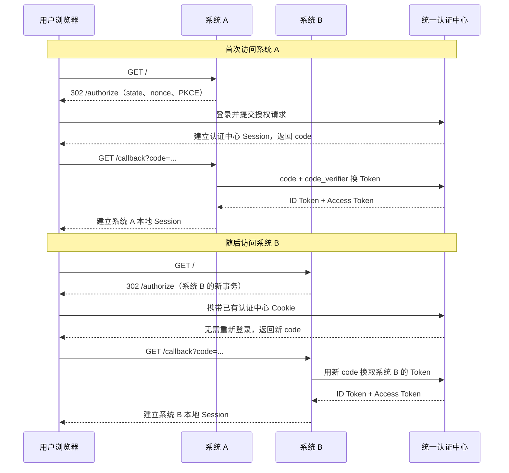

# SSO 单点登录设计

> **题目**：公司有管理后台、数据平台和营销平台等多个系统。用户登录其中一个系统后，再打开其他系统时不需要重复输入账号密码。你会如何设计？

SSO 的本质不是让所有系统共享一个 Cookie，而是让各业务系统信任同一个认证结果。不同主域之间不能共享 Cookie；即使都在同一父域下，共享父域 Cookie 也会扩大泄露面并耦合所有系统，因此更通用的方案是统一认证中心加 OIDC 授权码流程。

## 90 秒回答

我会建立统一认证中心，并把每个业务系统注册成独立的 OIDC Client。用户访问系统 A 时，如果 A 没有本地 Session，就生成一次性的 `state`、`nonce` 和 PKCE 参数，再跳转认证中心。认证中心完成登录后只把短期、一次性的授权码返回给 A；A 的 Node.js 后端校验回调并用授权码换取 ID Token 和 Access Token，随后轮换 Session ID，只在自己的服务端 Session 中保存必要的用户信息。

用户再访问系统 B 时，B 也跳转认证中心。浏览器会带上认证中心域下已有的 Session Cookie，认证中心确认用户已经登录后直接向 B 签发新的授权码，因此无需再次输入密码。A、B 各自只持有自己的会话或面向自身受众的令牌，不需要互相读取 Cookie 或 `localStorage`。

安全上要精确校验 `redirect_uri`、issuer、audience、签名、有效期、`state`、`nonce` 和 PKCE，Access Token 不进入 URL、日志或前端长期存储。退出还要区分本地退出、认证中心退出和全局退出；全局退出需要认证中心通过 Front-channel 或 Back-channel Logout 通知其他系统清理本地会话，不能只删除当前系统的 Cookie。

## 核心流程



认证中心的 Cookie 只属于认证中心。业务系统 A 和 B 各自建立本地 Session，所以某个系统被攻破时，不会直接获得其他系统的 Session Cookie。

## 为什么使用 Authorization Code + OIDC

- OAuth 2.0 解决委托授权；OIDC 在其上增加身份层，通过 ID Token 表达“用户是谁”。只说“用 OAuth 登录”不够严谨。
- 授权码短期、一次性使用，真正的 Token 由后端从 Token Endpoint 获取，不暴露在浏览器 URL、历史记录和 Referer 中。
- PKCE 把授权码绑定到发起登录的客户端事务。即使 code 被截获，没有对应的 `code_verifier` 也不能兑换 Token。
- `state` 绑定浏览器中的登录事务并防止伪造回调；`nonce` 绑定 OIDC 请求与 ID Token，防止 ID Token 重放。三者每次登录都要重新生成并保存在用户 Session 中。
- 成熟 OIDC 库负责发现端点以及校验签名、issuer、audience、有效期和 nonce，不要自己拼 JWT 校验逻辑。

不要使用已经不推荐的 Implicit Flow，也不要把长期 Access Token 放入 `localStorage` 后尝试让不同域的应用读取。`localStorage` 受同源策略限制，并且其中的 Token 可被同源 XSS 代码直接读取。

## Node.js 简单实现

下面的示例把系统 A 作为一个服务端 Web 应用（Confidential Client），使用 Express、服务端 Session 和 `openid-client` 6.x 演示核心链路。认证中心可以是支持标准 OIDC Discovery 的 Keycloak、Auth0、企业 IdP 或自建认证服务。

安装依赖：

```bash
pnpm add express express-session openid-client
```

把文件保存为 `server.mjs`，并在认证中心预先注册：

```text
redirect_uri:              https://a.example.com/callback
post_logout_redirect_uri:  https://a.example.com/
```

```js
import express from 'express';
import session from 'express-session';
import * as oidc from 'openid-client';

const app = express();
const appOrigin = process.env.APP_ORIGIN ?? 'http://localhost:3000';
const redirectUri = `${appOrigin}/callback`;

const oidcConfig = await oidc.discovery(
	new URL(process.env.OIDC_ISSUER),
	process.env.OIDC_CLIENT_ID,
	process.env.OIDC_CLIENT_SECRET
);

app.use(
	session({
		name: 'system_a_sid',
		secret: process.env.SESSION_SECRET,
		resave: false,
		saveUninitialized: false,
		cookie: {
			httpOnly: true,
			secure: process.env.NODE_ENV === 'production',
			sameSite: 'lax',
			maxAge: 8 * 60 * 60 * 1000
		}
	})
);

function regenerateSession(request) {
	return new Promise((resolve, reject) => {
		request.session.regenerate((error) => (error ? reject(error) : resolve()));
	});
}

function destroySession(request) {
	return new Promise((resolve, reject) => {
		request.session.destroy((error) => (error ? reject(error) : resolve()));
	});
}

function requireLogin(request, response, next) {
	if (!request.session.user) return response.redirect('/login');
	next();
}

app.get('/login', async (request, response, next) => {
	try {
		// 每次登录生成独立事务参数，并只保存在当前用户的服务端 Session 中。
		const codeVerifier = oidc.randomPKCECodeVerifier();
		const codeChallenge = await oidc.calculatePKCECodeChallenge(codeVerifier);
		const state = oidc.randomState();
		const nonce = oidc.randomNonce();

		request.session.oidcTransaction = { codeVerifier, state, nonce };

		const authorizationUrl = oidc.buildAuthorizationUrl(oidcConfig, {
			redirect_uri: redirectUri,
			response_type: 'code',
			scope: 'openid profile email',
			code_challenge: codeChallenge,
			code_challenge_method: 'S256',
			state,
			nonce
		});

		response.redirect(authorizationUrl.href);
	} catch (error) {
		next(error);
	}
});

app.get('/callback', async (request, response, next) => {
	try {
		const transaction = request.session.oidcTransaction;
		if (!transaction) return response.status(400).send('登录事务不存在或已过期');

		// 回调参数只能使用一次；失败后应重新发起登录，而不是复用旧事务。
		delete request.session.oidcTransaction;

		const callbackUrl = new URL(request.originalUrl, appOrigin);
		const tokens = await oidc.authorizationCodeGrant(oidcConfig, callbackUrl, {
			pkceCodeVerifier: transaction.codeVerifier,
			expectedState: transaction.state,
			expectedNonce: transaction.nonce,
			idTokenExpected: true
		});
		const claims = tokens.claims();

		// 登录成功后轮换 Session ID，防止会话固定攻击。
		await regenerateSession(request);
		request.session.user = {
			sub: claims.sub,
			name: claims.name,
			email: claims.email
		};
		request.session.idToken = tokens.id_token;

		response.redirect('/');
	} catch (error) {
		next(error);
	}
});

app.get('/', requireLogin, (request, response) => {
	response
		.type('text/plain')
		.send(`你好，${request.session.user.name ?? request.session.user.sub}`);
});

app.post('/logout', requireLogin, async (request, response, next) => {
	try {
		const idToken = request.session.idToken;
		await destroySession(request); // 先清当前系统的本地登录态
		response.clearCookie('system_a_sid');

		if (!oidcConfig.serverMetadata().end_session_endpoint) {
			return response.redirect('/');
		}

		// 再请求认证中心退出；跳转地址必须提前在认证中心登记。
		const logoutUrl = oidc.buildEndSessionUrl(oidcConfig, {
			id_token_hint: idToken,
			post_logout_redirect_uri: `${appOrigin}/`
		});
		response.redirect(logoutUrl.href);
	} catch (error) {
		next(error);
	}
});

app.listen(3000);
```

示例有意省略用户落库、Refresh Token、权限加载和多设备管理，只展示 SSO 最小主链路。生产环境还需要：

1. 用 Redis 等共享 Session Store 替代 `express-session` 的默认内存存储，并设置过期、并发登录和撤销策略。
2. `SESSION_SECRET`、Client Secret 放入密钥管理系统；全链路使用 HTTPS，不记录 code、Token 和 Session ID。
3. 在反向代理后正确配置可信代理和外部 HTTPS 地址；不要直接信任任意 `Host`、`X-Forwarded-*` 头来拼回调 URL。
4. 限制登录发起频率，为 OIDC 事务设置短过期和一次性消费；错误页使用统一提示，但保留内部可关联的审计信息。
5. 如果需要调用下游 API，把短生命周期 Access Token 保存在服务端，并按 issuer、audience 和 scope 做校验；不要把 ID Token 当 API Access Token。
6. 如果使用 Refresh Token，启用轮换和重用检测。用户改密、禁用、风险事件或主动退出时，应支持撤销或服务端会话版本失效。

## 退出不是只删一个 Cookie

| 退出层次               | 行为                                                               |
| ---------------------- | ------------------------------------------------------------------ |
| Local Logout           | 只销毁当前业务系统的本地 Session；认证中心仍登录，再访问可无感登录 |
| RP-Initiated Logout    | 当前系统请求认证中心结束统一登录会话                               |
| Single / Global Logout | 认证中心还要通知 A、B、C 等系统分别清理本地 Session                |

全局退出通常使用 OIDC Front-channel Logout 或 Back-channel Logout。前者依赖浏览器访问各系统的注销地址，受浏览器 Cookie 策略和页面加载影响；后者由认证中心直接调用各系统的后端注销端点，可靠性更好，但各系统必须验证 Logout Token、保证幂等，并处理暂时失败和重试。

JWT 无状态并不等于“天然支持退出”。如果资源服务只离线验签，已签发的 Access Token 在到期前仍可能有效。常见折中是短生命周期 Access Token、可轮换和撤销的 Refresh Token，以及用于高风险场景的会话版本、denylist 或令牌内省。

## 微服务环境下如何落地

```text
Browser -> BFF / Gateway -> Auth Server
                       \-> User / Order / Report Service
```

- 认证由认证中心负责；网关/BFF 接收并校验适用于自身 audience 的 Access Token。
- 授权不应只放在网关。网关可做粗粒度拦截，业务服务仍要校验资源归属、租户、角色和业务状态。
- 网关传递用户上下文时，下游只信任来自受控网络、mTLS 或签名机制的内部信息，不能信任客户端自行提交的 `X-User-Id`、`X-Role`。
- 不要签发一个能访问所有服务的超大权限 Token。按 audience 和 scope 隔离，缩小令牌泄露后的影响范围。

## 递进追问

### 1. 为什么不直接共享父域 Cookie？

`a.example.com`、`b.example.com` 技术上可以读取设置为 `Domain=.example.com` 的 Cookie，但这会让所有匹配子域共享高价值凭证，一个弱子域就可能扩大整体风险；系统也会被同一主域绑定。统一认证中心只让浏览器把认证 Cookie 发给认证域，各业务系统通过标准协议获得自己的认证结果，边界更清晰，也支持不同主域。

### 2. 为什么不能让系统 B 读取系统 A 的 JWT？

不同源的 `localStorage` 不能互相读取。即使通过 URL、iframe 或共享父域绕过去，也会扩大 XSS、日志泄露和错误受众接受的风险。B 应向认证中心发起自己的授权请求，获得面向 B 的授权码和 Token。

### 3. code 被截获了怎么办？

使用一次性、短时效授权码并绑定精确 `redirect_uri` 和 PKCE。攻击者即使截获 code，没有保存在原登录事务中的 `code_verifier` 也无法换 Token。回调仍需校验 `state`、`nonce`、issuer 和 audience。

### 4. JWT 被偷了怎么办？

先用 HTTPS、HttpOnly Cookie、CSP、最小权限和避免日志泄露降低被盗概率；再用短 Access Token、Refresh Token Rotation、重用检测、设备/会话管理和撤销能力缩短影响时间。高风险接口还可以要求重新认证，不能只看一个尚未过期的 JWT。

### 5. A 退出后，为什么 B 可能仍然可用？

因为 A 的本地 Session、B 的本地 Session 和认证中心 Session 是三份独立状态。只清 A 不会自动清 B；即使清了认证中心，B 现有 Session 也可能继续有效。全局退出必须定义通知、重试、幂等和最终一致性策略。

### 6. SSO 是否等于所有系统权限一致？

不是。SSO 只复用认证结果，回答用户是谁；每个系统仍要根据自己的租户、角色、资源归属和业务状态做授权。认证中心返回的身份不能替代订单、文件等资源的对象级鉴权。

### 7. 认证中心挂了，已登录用户还能访问吗？

取决于本地 Session 和 Access Token 策略。已有本地 Session 可以在其有效期内继续工作，但新登录、续期、统一退出和权限紧急回收可能受影响。设计时要明确失败模式、缓存密钥、熔断降级和安全优先级，不能默认失败时放行。

### 8. 面试时如何压缩成一句话？

> 每个业务系统都是独立 OIDC Client：没有本地 Session 就携带 state、nonce 和 PKCE 跳转统一认证中心，以一次性 code 在后端换 Token 并建立自己的 Session；后续系统利用认证中心已有 Cookie 完成无感认证，同时保留各系统独立授权与会话边界，全局退出则通过标准注销协议协调清理各系统 Session。

## 关联内容

- [认证方案：Cookie / Session / JWT](../04-浏览器与网络/认证方案对比.md)
- [认证、授权与会话安全](../13-Web安全/认证、授权与会话安全.md)
- [XSS 与前端注入](../13-Web安全/XSS与前端注入.md)
- [CSRF 与跨站请求防护](../13-Web安全/CSRF与跨站请求防护.md)

## 参考

- [OpenID Connect Core 1.0](https://openid.net/specs/openid-connect-core-1_0-18.html)
- [OAuth 2.0 Security Best Current Practice（RFC 9700）](https://www.rfc-editor.org/rfc/rfc9700.html)
- [OpenID Connect RP-Initiated Logout 1.0](https://openid.net/specs/openid-connect-rpinitiated-1_0.html)
- [OpenID Connect Back-Channel Logout 1.0](https://openid.net/specs/openid-connect-backchannel-1_0.html)
- [`openid-client` 6.x 文档与示例](https://github.com/panva/openid-client)
