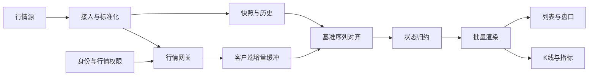

# 实时行情与金融场景

这部分根据 JD 与官方产品能力设计，属于场景练习。公司实际协议、交易规则、技术栈和规模需要面试时确认。

## 一、最小业务词汇

- Tick：一次成交或报价变化；报价事件不一定包含成交量。
- OHLCV：一段时间的开、高、低、收和成交量。
- 快照：明确时点/版本的完整状态；增量：此后的状态变化。
- 盘口：多个买卖价位及数量；增量常涉及某个价位的新增、修改或删除。
- Level 2：更丰富的深度行情，数据授权与市场规则需要单独确认。
- 复权：公司行动影响下的历史价格处理，前复权、后复权和未复权不能混接。
- 订单状态机：部分成交、撤单、拒绝等存在合法转换，不能只做“成功/失败”两个值。
- 交易日：按市场时区、交易日历和交易阶段判断，不能用设备本地日期替代。

## 二、两分钟回答

> 我先确认展示哪些市场、数据频率、权限、延迟目标和现有协议。架构分成快照、增量、连接管理、状态归约和渲染五层。最关键的是快照和增量必须能对齐：例如先订阅并缓冲，再拿带基准序列号的快照，装载后应用快照之后的增量，防止两次请求之间漏数。
>
> 同一页面上下文内按权限和频道复用连接，用引用计数管理订阅。重连采用带随机抖动的退避，并根据最后确认位置补发；不支持补发就重新同步。还会区分正常退订、鉴权失效、网络断开和数据长期不更新。
>
> 展示层不会每收到一条行情就重渲染。最新报价可以按标的合并，盘口变化和成交先完整归约，再按帧或时间片提交视图；列表虚拟化，指标重计算根据测量放 Worker。
>
> 交易链路独立处理：请求超时属于结果未知，使用稳定幂等键和权威订单查询收敛状态。监控除了 FPS，还要看数据新鲜度、端到端延迟、缺口、重连、积压和失败率。

## 三、总体数据流

下图是练习用分层，不代表华盛通的内部架构。

## 四、快照与增量：必须讲清的竞态

### 一种可行协议

1. 建立订阅，服务端确认订阅已生效，客户端开始缓冲增量。
2. 请求同一数据流的快照，返回 `snapshotSeq=S`。
3. 装载快照，丢弃不高于 S 的缓冲事件。
4. 按协议规定的顺序应用 S 之后的事件，进入实时消费。
5. 发现缺口、缓冲超上限或快照太旧，停止使用该状态并重新同步。

前提：快照序列与增量序列可比较，服务端明确序列作用域，且缓冲覆盖快照之后的变化。另一种方案是快照接口返回可恢复游标，订阅端支持从游标补发。

### 不能保证的情况

如果服务端没有快照版本、恢复游标或原子切换协议，客户端单靠时间戳和“收到就覆盖”无法严格保证不漏数据。可做最终一致性校准，但要说明能力限制。

### 不要误诊 TCP 乱序

同一 WebSocket 连接在传输层保序。业务乱序可来自多个数据源、重连交叠、异步解析或上游发送顺序。序列号用于业务去重、恢复和一致性，不能据此说 TCP 本身随机乱序。

全局序列被过滤到一个标的后可能不连续。只有协议明确频道内连续编号时，才按 `lastSeq + 1` 检测缺口。

## 五、连接与权限

- 在同一用户、市场权限和频道约束下复用连接；不能不加前提地说所有端永远只有一条连接。
- 订阅键至少包含市场、标的和频道；两个组件订阅同一个键，最后一个解除后才真正退订。
- Web 页面生命周期、账号切换、权限变化和断线重连都要维护订阅集合。
- 浏览器 WebSocket API 不暴露主动发送协议 Ping 帧的接口，心跳可以由服务端或应用层消息实现。
- 浏览器构造器不能任意加 Authorization 头；鉴权可使用安全 Cookie 或短期票据，并校验 Origin、会话及每个订阅的权限。
- online 事件只表示可尝试重连；连接打开也不意味着数据新鲜，需独立检查最后有效事件时间。
- 重连要清除旧连接的事件影响，使用连接代数或实例身份忽略陈旧回调。

## 六、背压与高频渲染

传统浏览器 WebSocket API 没有自动接收背压；批量渲染只能减少视图更新，不能自动降低网络接收和消息解析成本。

| 数据类型      | 可以怎样合并                     | 不可忽略的约束                           |
| ------------- | -------------------------------- | ---------------------------------------- |
| 完整最新报价  | 同标的保留时间片内最新值         | 前提是消息为完整值；部分字段补丁需先合并 |
| 盘口增量      | 按顺序归约到盘口状态，再合并绘制 | 不能直接丢掉价位删除、数量更新           |
| 成交 Tick     | 服务端聚合或完整处理后再展示     | OHLCV 和成交量不能只取最后一次价格       |
| 订单/成交事件 | 可靠归约、查询对账与状态机       | 不能用行情采样策略丢弃业务事件           |

优化顺序：

1. 用性能记录区分消息解析、状态提交、React/Vue 更新、绘制和 GC。
2. 限制频道、标的数量和订阅速率；必要时协商服务端采样或聚合。
3. 限制缓冲长度与年龄，超过阈值标记数据失真并重新同步。
4. 报价使用细粒度订阅和虚拟列表，避免整页随每个 Tick 更新。
5. 只有确认计算占比高时，才把解析或指标计算移入 Worker，评估消息复制成本。
6. 后台页面降低订阅/推送频率，恢复前台后校准；不能只停止 rAF 让内存无限积压。

核对：[MDN WebSocket](https://developer.mozilla.org/en-US/docs/Web/API/WebSocket)、[Node.js Stream](https://nodejs.org/api/stream.html)。Node 可写流的 `write(false)` / drain 与浏览器 WebSocket 接收背压不是同一个机制。

## 七、K 线与图形：准备到这个深度即可

数据链路：历史 Bar → 对齐时间区间和复权方式 → 实时更新当前 Bar → 处理周期切换、补历史和重连校准。

- 高低价来自区间内所有必要成交；只留最新价会丢掉极值。
- 成交量先确认是单笔增量还是累计值；累计值直接求和会重复计算。
- 切换标的或周期使用请求代数/取消机制，忽略旧请求写回。
- Canvas 适合常规图表；是否用 WebGL 要看实际点数、图层、设备和性能预算。
- TradingView 接入要先确认用哪个产品及许可，再关注历史与实时数据适配；不同图表产品的 API 和授权不同。
- 绘制可分背景、数据与交互层，关注 DPR、可见区裁剪和指针更新频率。
- 颜色、鼠标/触摸、键盘和无障碍需要独立设计，绘制 API 不负责全部交互。

没有 TradingView/WebGL 生产经历时，能解释以上输入、边界和选型已经足够，不用临时背图形管线源码。

## 八、SSR 与 BFF

资讯、产品介绍和公开股票资料可按新鲜度选择静态生成、再验证或请求时渲染。实时面板可以服务端输出快照、客户端继续订阅；Client Component 首次也可能参与服务端 HTML 预渲染。

BFF 聚合账户、行情和资讯时，要划清鉴权、超时、部分降级、日志和缓存边界。用户资产和订单响应不能进入跨用户公共缓存；最终风控、购买力和订单合法性由交易领域服务负责。

追问准备：

- 为什么不在 SSR 阶段开一个永远不关闭的用户行情连接？
- 一个依赖超时，哪些区域可以显示缓存，哪些必须拒绝操作？
- 服务端数据、HTML、CDN、客户端缓存分别怎样避免串用户？

## 九、下单超时与幂等

> 我先把状态展示为“处理中/结果待确认”，保留原幂等键，查询权威订单状态。查询暂时不存在不代表原请求没有被受理，可能有读延迟或处理仍在继续。协议允许时只能按原键重试，并由服务端唯一约束、参数摘要和交易通道客户端订单号共同防重。

服务端需要：

- 同一用户范围内明确幂等键和有效期，同键不同参数拒绝。
- 区分处理中、成功、明确失败；成功时返回同一订单与结果。
- 事务/条件更新约束订单状态，外部回调去重并对账。
- 记录请求与订单关联、审计和指标，日志不泄漏账户与凭据。

前端禁用按钮只是交互措施。HTTP 请求取消、超时或页面退出都不能证明下游订单被取消。

## 十、四个递进场景

### 快照拿到后发现缓冲区缺一段

先标记该频道数据待同步，按协议请求缺口补发；无补发能力就重拿快照。展示注明数据陈旧，对依赖该状态的敏感操作按业务规则限制。不能继续按猜测拼接。

### 页面从后台回来显示旧价

rAF 在后台可能暂停，不能把后台积压全部逐条重放到 UI。检查连接、最后事件时间和数据基准，按允许的状态合并或重新同步，再恢复正常频率。

### 某国家白屏但接口全部 200

检查入口脚本实际执行、Chunk 版本、HTML 内容是否被 CDN/WAF 替换、语法支持、语言包与第三方依赖。200 只证明 HTTP 状态，不证明返回了正确 JS/JSON。按地区真实样本比对响应内容、类型和错误栈。

### 用户设备日期和市场日期不同

UTC 时间戳用于传输，市场时区和交易日历用于业务判断，用户 locale 用于展示。夏令时、半日市、休市和盘前盘后由领域规则定义，不能只加减固定小时数。

## 十一、面试中的经验边界

> 证券核心交易不是我过去的生产主线。这个方案是基于通用实时系统与岗位场景的设计；落地前我会先确认公司协议、权限、交易规则和现有监控。能直接迁移的是复杂前端、流式状态、Node.js 任务可靠性和排障能力。
